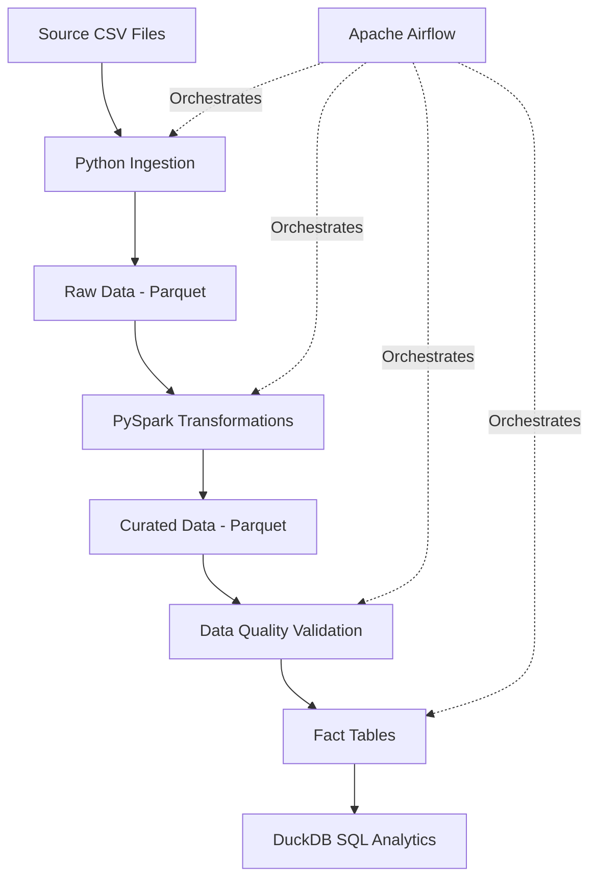
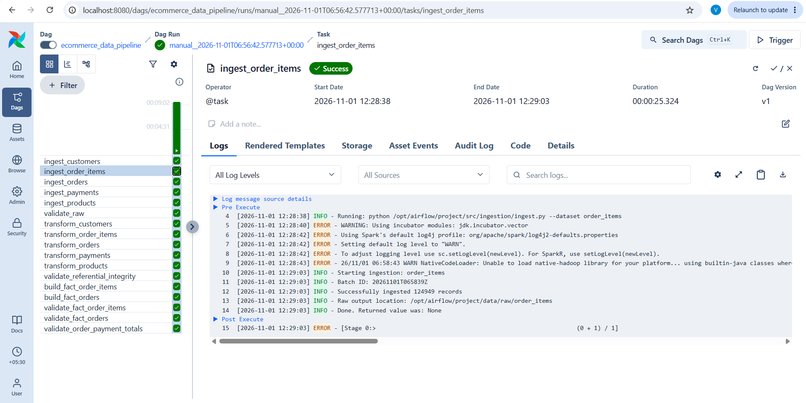

# End-to-End E-Commerce Data Engineering Pipeline

An end-to-end data engineering project that ingests, transforms, validates, and analyzes synthetic e-commerce data using Python, PySpark, Apache Airflow, Docker, and SQL.

## Project Overview

This project demonstrates how an e-commerce data platform can process raw business data and transform it into analytics-ready datasets.

The pipeline covers the complete data engineering lifecycle, including:
- Batch data ingestion
- Raw data storage using Parquet
- Data cleansing and transformation using PySpark
- Data quality and referential integrity validation
- Fact table development
- SQL-based business analytics
- Workflow orchestration using Apache Airflow

## Architecture



## Technology Stack

| Technology | Purpose |
|---|---|
| Python | Data ingestion and pipeline development |
| PySpark | Distributed data processing and transformation |
| Apache Airflow | Workflow orchestration |
| Docker & Docker Compose | Containerization and environment management |
| Parquet | Columnar data storage |
| DuckDB | SQL analytics |
| Git & GitHub | Version control |

## Dataset Overview

The project uses synthetic e-commerce datasets.

| Dataset | Records |
|---|---:|
| Customers | 10,000 |
| Products | 2,000 |
| Orders | 50,000 |
| Order Items | 124,949 |
| Payments | 50,000 |
| **Total** | **236,949** |

The datasets contain customer, product, order, order-item, and payment information.

No real customer or payment information is used.

## Pipeline Workflow

### 1. Data Ingestion

Developed a reusable Python ingestion framework that:
- Reads source CSV files.
- Validates required columns.
- Adds ingestion metadata.
- Generates unique batch IDs.
- Stores raw data in partitioned Parquet format.
- Preserves historical ingestion batches.

### 2. Data Transformation

Implemented PySpark transformations for all five datasets.

Key operations:
- Data cleansing and standardization.
- Data type conversions.
- Duplicate removal.
- Mandatory field validation.
- Invalid record filtering.

### 3. Data Quality Validation

Implemented automated validation checks covering:
- Raw dataset record counts.
- Duplicate and null identifier checks.
- Referential integrity.
- Missing source records.
- Mandatory field validation.
- Order and payment amount reconciliation.

### 4. Fact Table Development

Created two analytics-ready fact tables.

**fact_order_items**
- One record per order item.
- Includes customer, product, order, and payment attributes.

**fact_orders**
- One record per order.
- Includes order totals, item counts, quantities, customer details, and payment information.

### 5. SQL Analytics

Developed seven SQL queries using DuckDB:

1. Revenue Summary
2. Category Performance
3. City Performance
4. Monthly Revenue
5. Payment Analysis
6. Top Products
7. Order Metrics

## Airflow Orchestration

The complete workflow is orchestrated using Apache Airflow.

The DAG executes:
1. Ingestion of five datasets.
2. Raw data validation.
3. PySpark transformations.
4. Referential integrity validation.
5. Fact table generation.
6. Final data quality checks.

**Execution status:** Successfully completed the first end-to-end Airflow DAG run.


## Project Results

| Metric | Result |
|---|---:|
| Total source records | 236,949 |
| Curated customers | 10,000 |
| Curated products | 2,000 |
| Curated orders | 50,000 |
| Curated order items | 124,949 |
| Curated payments | 50,000 |
| Fact order records | 50,000 |
| Fact order-item records | 124,949 |
| Referential integrity failures | 0 |
| Order-payment mismatches | 0 |

## Repository Structure

```text
ecommerce-data-engineering/
│
├── data/
│   ├── source/
│   ├── raw/
│   └── curated/
│
├── src/
│   ├── ingestion/
│   ├── transformations/
│   │   └── facts/
│   ├── validation/
│   └── utils/
│
├── dags/
│   └── ecommerce_pipeline.py
│
├── sql/
│   └── analytics/
│
├── tests/
├── scripts/
│   └── generate_data.py
│
├── config/
├── plugins/
├── logs/
├── Dockerfile
├── docker-compose.yaml
├── requirements.txt
└── README.md
```

## Future Enhancements

- Integrate AWS S3 for cloud-based data storage.
- Implement AWS Glue and Athena for cloud analytics.
- Add incremental processing and backfill capabilities.
- Introduce automated data quality reporting.
- Add CI/CD integration using GitHub Actions.
- Implement monitoring and alerting.

## Getting Started

### Prerequisites

- Python 3.11+
- Java 17
- Docker Desktop
- Git

### Clone the Repository

```bash
git clone https://github.com/vicky-uv/ecommerce-data-engineering.git

cd ecommerce-data-engineering
```

### Create a Virtual Environment

```bash
python -m venv venv
```

Activate on Windows PowerShell:

```powershell
.\venv\Scripts\Activate.ps1
```

### Install Dependencies

```bash
pip install -r requirements.txt
```

### Generate Synthetic Data

```bash
python scripts/generate_data.py
```

### Start Airflow

Configure the required Airflow environment and `.env` file as described in the project setup, then run:

```bash
docker compose up airflow-init

docker compose up -d
```

Access the Airflow UI:

```text
http://localhost:8080
```

Unpause and trigger `ecommerce_data_pipeline` to execute the workflow.

## Author

**Vignesh**

Data Engineer | PySpark | Python | SQL | Apache Airflow | AWS

GitHub: [vicky-uv](https://github.com/vicky-uv)